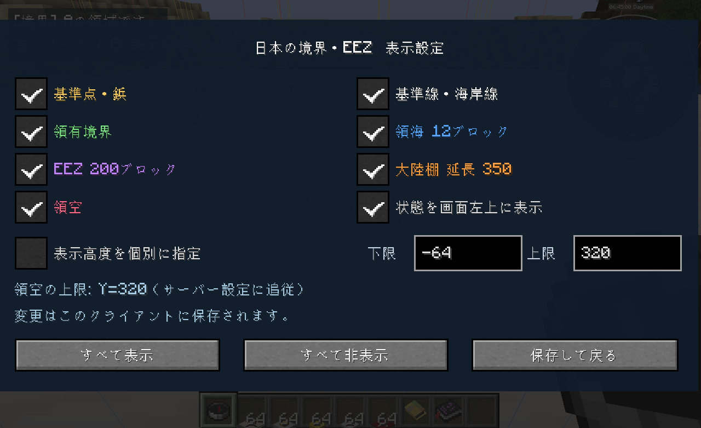

# 領域クラフト / 領土・領海・領空 Fabric Mod

Minecraftのワールドで、基準点や領有境界、領海、EEZ、大陸棚、領空を確認できるFabric 1.20.1用Modです。

三角点や測量鋲を置いて領域を作り、境界確認ツールを持つと、その範囲を枠線で表示します。表示する境界は、ゲーム内の設定画面から選べます。

## できること

- 三角点・水準点・金属鋲・測量鋲・境界標を設置できます。すべて厚み0.2ブロックの小型モデルで、ブロックの中央に置かれます。
- 基準点の位置や、地下から上空までの境界を、構造物ブロックの範囲表示に似た枠線で確認できます。
- 海岸線からの距離を基に、領海・EEZ・大陸棚を表示できます。
- 領域に所有者を設定し、入ったときに「Aの領域です。」などのタイトルを表示できます。通知は無効にもできます。

<details>
<summary>表示設定の画面</summary>

基準点・基準線・領有境界・領海・EEZ・大陸棚・領空を、1つのツールで切り替えられます。



</details>

## 対応環境

| 必要なもの | 対応するバージョン |
|---|---|
| Minecraft Java Edition | 1.20.1 |
| Java | 17以上 |
| Fabric Loader | 0.15.0以上 |
| Fabric API | Minecraft 1.20.1に対応したもの |

サーバーとクライアントで、同じJarを使用します。シングルプレイの場合は、クライアントに入れるだけで使えます。

## 導入方法

1. Fabric LoaderとFabric APIを導入してください。
2. [Releases](https://github.com/miniai-saka/japan-eez/releases)から、お使いのMinecraftに対応したJar（例：`japan-eez-1.20.1-x.x.x.jar`）をダウンロードし、`mods`フォルダーへ入れてください。
3. マルチプレイでは、サーバー側と接続する各クライアントの両方へ入れてください。

## まず使ってみる

`/jpboundary tool`で「境界確認ツール」を受け取れます。クリエイティブでは「日本の境界・EEZ」タブから、サバイバルではコンパス・アメジストの欠片・鉄塊のクラフトでも入手できます。

ツールをメインハンドかオフハンドに持つと、近くの境界を表示します。空中へ右クリック、または**Bキー**で表示設定を開き、見たい項目にチェックを入れてください。手から外すと、枠線は消えます。

表示の上下限も設定できます。初めて持ったときや移動した直後は、海岸線の調査が終わるまで少し時間がかかります。

## 自分で領域を作る

領域の編集と共通設定の変更には、OP権限レベル2が必要です。シングルプレイで編集する場合は、チートを有効にしてください。

まず、領域のIDと所有者を指定します。

```mcfunction
/jpboundary region create area_a A
```

境界の角に測量標を置き、外周をたどる順番に、ツールで**Shift＋右クリック**してください。3点以上追加したら、次のコマンドで確定します。

```mcfunction
/jpboundary region close area_a
```

領域内に入ると「Aの領域です。」と表示されます。頂点の追加・取り消しや、所有者の変更については、[操作と設定](docs/usage.md)にまとめています。

## 海域の範囲

このModでは、**1海里を1ブロック**として扱います。初期設定は次のとおりです。

| 区分 | 海岸線からの距離 |
|---|---:|
| 領海 | 12ブロック以内 |
| EEZ | 200ブロック以内 |
| 延長大陸棚 | 最大350ブロック |

砂浜を海岸側として、そこから続く通常の海を大陸棚として扱います。深い海は大陸棚に含めません。ただし、海岸から200ブロック以内であれば、深い海もEEZには含まれます。

延長大陸棚を有効にすると、200ブロックを超えても通常の海が連続している部分を、最大350ブロックまで大陸棚として扱います。EEZの範囲は200ブロックのままです。

## 設定を変える

共通設定は`config/japan-eez.json`、表示の切替などは`config/japan-eez-client.json`へ保存されます。マルチプレイで距離・高度・通知を変える場合は、サーバー側の共通設定を変更してください。

コマンドから変更した内容は、設定ファイルにも保存されます。

```mcfunction
/jpboundary config set extendedShelf false
/jpboundary config set airspaceTopY 512
/jpboundary config set notifications false
```

ファイルを直接編集した場合は、`/jpboundary config reload`で読み直せます。地下の下限、枠線の色、測量標の設置可否など、[詳しい設定項目](docs/usage.md#設定項目)も変更できます。

## 利用前に確認してほしいこと

- 海岸線は、生成時のバイオームを基に判定します。初期の調査・枠表示は4ブロック間隔なので、枠線には段差や丸めが生じます。埋め立てや`/fillbiome`による変更は判定に反映しません。
- 領有権は、所有者の記録・境界表示・進入通知に使います。採掘・建築・PvPを制限する保護機能はありません。
- 距離や大陸棚は、このMod独自のゲーム内ルールです。現実の日本の国境やEEZを読み込む機能はありません。

表示範囲や海岸線の調べ方など、詳しい仕組みは[海域と領空の判定](docs/marine-rules.md)にまとめています。

## 開発・ライセンス

ソースからビルドする場合は、[開発用の手順](docs/development.md)を参照してください。

作者：**miniai-saka**

ライセンスは[MIT License](LICENSE)です。改変・再配布する場合は、同ライセンスの著作権表示と許諾表示を含めてください。
